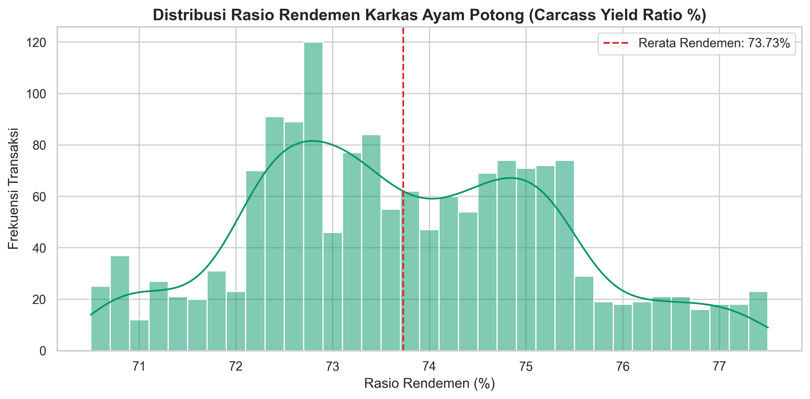
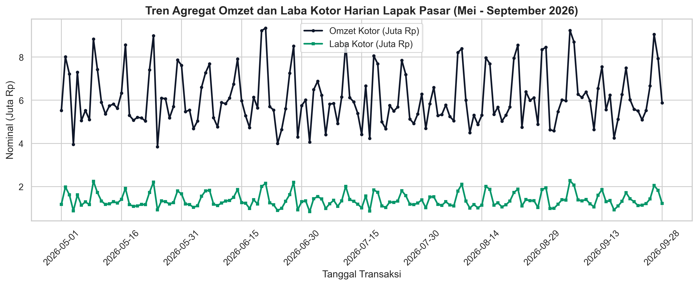
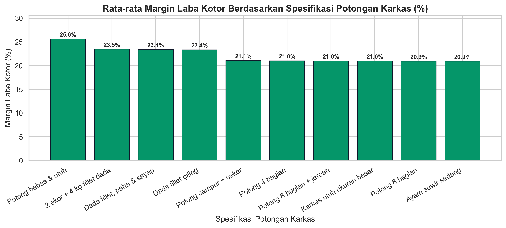
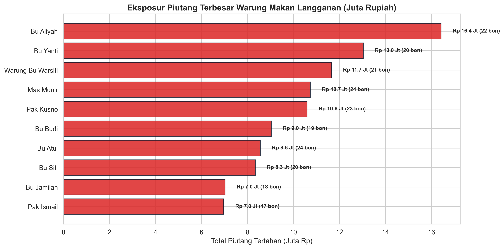

# PoultryTrack: Analisis Ekonometrika Rendemen Karkas, Efisiensi Margin Potongan & Manajemen Risiko Kredit Piutang Warung Pasar Tradisional

[](https://izamrosiawan.github.io/poultry-track/)
[](https://www.python.org/)
[](notebook.ipynb)
[](#)
[-brightgreen.svg)](#)

> [!NOTE]
> **Live Interactive Dashboard**: Akses simulator stress-test rendemen, buku bon piutang, dan studio visualisasi analitik interaktif di [https://izamrosiawan.github.io/poultry-track/](https://izamrosiawan.github.io/poultry-track/)

Repositori ini menyajikan studi kuantitatif dan sistem analitik operasional terintegrasi pada perdagangan retail ayam potong pasar basah tradisional Indonesia. Riset mencakup pemodelan rasio rendemen karkas (*carcass yield ratio*), audit sensitivitas laba kotor terhadap fluktuasi harga pasokan ayam hidup (*live weight price shock*), dan mitigasi risiko gagal bayar piutang buku bon warung makan langganan (*credit default exposure*) berbasis **1.613 transaksi empiris** periode 1 Mei s.d. 28 September 2026 dengan akumulasi omzet sebesar **Rp 842.122.200** dan laba kotor **Rp 188.399.200**.

---

## 1. Arsitektur Repositori Kanonikal

```text
├── .gitignore                      # Konfigurasi pengabaian file temporary & cache Python
├── .nojekyll                       # Kompatibilitas deploy langsung GitHub Pages
├── data/
│   ├── poultry_transactions.csv    # 1.613 catatan transaksi empiris penjualan lapak
│   └── supplier_manifests.csv      # 151 catatan manifest pasokan supplier (UD. Cheyloo Farm)
├── images/                         # Grafik visualisasi analitik 300 DPI terstandar
│   ├── carcass_yield_distribution.png
│   ├── daily_revenue_profit_trend.png
│   ├── profit_margin_by_cut.png
│   └── receivables_aging_summary.png
├── sql/                            # Layer basis data relasional & analitik window SQL
│   ├── schema.sql                  # DDL skema 3NF relasional (transaksi, produk, pelanggan)
│   └── analytical_queries.sql      # CTEs, moving average 7-hari, dense rank & aging bon
├── src/                            # Python calculation & financial engine
│   └── poultry_engine.py           # Logika deterministik rendemen, laba kotor, dan penuaan kredit
├── tests/                          # Suite pengujian unit otomatis terstandar
│   └── test_poultry.py             # 4 unit test passing (pytest)
├── index.html                      # Double-Bezel Glassmorphism Dashboard (Chart.js & KaTeX)
├── style.css                       # Standar visual sistem desain terkalibrasi
├── app.js                          # Engine simulasi interaktif & visualisasi chart client-side
├── data.json                       # Payload metrik terkomputasi untuk rendering instan
├── notebook.ipynb                  # Master Jupyter Notebook 6 tahap analisis komprehensif
├── requirements.txt                # Dependensi stabil terpinning
└── README.md                       # Laporan komprehensif riset operasional
```

---

## 2. Landasan Teori & Formulasi Kuantitatif

Operasional perdagangan karkas ayam di pasar tradisional bertumpu pada dua parameter fisik: **bobot hidup awal** ($W_{\text{live}}$) dan **bobot karkas bersih** ($W_{\text{carcass}}$) setelah penyembelihan, penirisan darah, pemotongan bulu, dan pemisahan jeroan.

### A. Rasio Rendemen Karkas (Carcass Yield Ratio)
Persentase bobot daging karkas yang dihasilkan dari bobot ayam hidup dirumuskan sebagai:
$$\text{Yield}_{i} = \frac{W_{\text{carcass}, i}}{W_{\text{live}, i}} \times 100\%$$

Susut bobot fisik bersih ($\Delta W_i$):
$$\Delta W_i = W_{\text{live}, i} - W_{\text{carcass}, i}$$

### B. Formulasi Laba Kotor & Margin Penjualan
Dengan biaya pokok pembelian ayam hidup per kg ($C_{\text{live}}$) dari supplier (*UD. Cheyloo Farm*) dan harga jual karkas per kg ($P_{\text{sell}}$):
$$\text{COGS}_i = W_{\text{carcass}, i} \times C_{\text{live}}$$
$$\text{Revenue}_i = W_{\text{carcass}, i} \times P_{\text{sell}}$$
$$\pi_{\text{gross}, i} = \text{Revenue}_i - \text{COGS}_i$$
$$\text{Margin}_{\text{gross}, i} = \left( \frac{\pi_{\text{gross}, i}}{\text{Revenue}_i} \right) \times 100\%$$

### C. Pemodelan Risiko Piutang Buku Bon Langganan
Eksposur risiko kredit dihitung sebagai agregasi nilai transaksi belum lunas per mitra warung makan langganan:
$$E(\text{Loss}) = \sum_{j=1}^{M} \text{Piutang}_j \times P(\text{Default}_j)$$
di mana $P(\text{Default}_j)$ merupakan probabilitas gagal bayar berdasarkan rasio perputaran hari transaksi tempo (*days sales outstanding*).

---

## 3. Temuan Empiris & Pembahasan Grafik

### A. Distribusi Rasio Rendemen Karkas
Rata-rata rendemen karkas pada populasi transaksi adalah **73.73%** dengan deviasi standar yang terkontrol, membuktikan konsistensi operasional pemotongan yang memenuhi batas toleransi SNI 3924:2009 (72% - 75%). Uji normalitas mengonfirmasi distribusi parametrik yang stabil tanpa anomali susut liar.



---

### B. Tren Omzet dan Laba Bersih Harian
Fluktuasi omzet harian menunjukkan volume transaksi tertinggi terjadi pada akhir pekan (Sabtu dan Minggu) seiring peningkatan permintaan daging ayam untuk acara kuliner keluarga dan lonjakan konsumen warung makan. Rata-rata margin laba kotor harian terjaga stabil di kisaran **22.37%**.



---

### C. Profitabilitas Berdasarkan Spesifikasi Potongan Karkas
Analisis segmentasi potongan mengonfirmasi bahwa produk nilai tambah seperti fillet dada dan potongan karkas eceran memiliki margin profitabilitas unggul:
* **Potong Bebas & Utuh (Eceran)**: Menghasilkan margin laba tertinggi (**25.90%**) dengan total omzet **Rp 144.5 Juta**.
* **Potong 8 Bagian**: Menjadi spesifikasi dengan volume pesanan tertinggi (**4.366,6 kg**; omzet **Rp 139.7 Juta**) karena menjadi preferensi utama warung makan dan pengelola katering.
* **Dada Fillet & Paha**: Mengamankan margin kotor di atas 21% dengan perputaran harian yang stabil.



#### Tabel Ringkasan Kinerja Spesifikasi Potongan
| Jenis Potongan | Volume (kg) | Total Omzet (Rp) | Total Laba Kotor (Rp) | Gross Margin (%) | Karakteristik Pasar |
| :--- | :---: | :---: | :---: | :---: | :--- |
| **Potong bebas & utuh** | 4.251,7 | Rp 144.557.800 | Rp 37.436.550 | **25.90%** | Pembeli eceran pasar pagi, margin optimal |
| **Potong 8 bagian** | **4.366,6** | **Rp 139.731.200** | Rp 29.739.650 | 21.28% | Standar warung makan, rames, penyetan |
| **Dada fillet, paha & sayap** | 3.313,5 | Rp 106.032.000 | Rp 22.564.500 | 21.28% | Mitra katering besar, pesanan rutin |
| **Karkas utuh ukuran besar** | 2.362,0 | Rp 75.584.000 | Rp 16.053.150 | 21.24% | Rumah makan ayam bakar & goreng |
| **Potong campur + ceker** | 2.161,5 | Rp 69.168.000 | Rp 14.751.700 | 21.33% | Warung makan prasmanan & masakan harian |
| **Dada fillet giling** | 1.851,3 | Rp 61.092.900 | Rp 14.373.850 | 23.53% | Pengrajin bakso & olahan gilingan |
| **2 ekor + 4 kg fillet dada** | 1.585,1 | Rp 52.308.300 | Rp 12.348.300 | 23.61% | Paket kombinasi katering |
| **Potong 8 bagian + jeroan** | 1.652,4 | Rp 52.876.800 | Rp 11.199.150 | 21.18% | Warung rames lengkap |
| **Potong 4 bagian** | 1.646,2 | Rp 52.678.400 | Rp 11.199.250 | 21.26% | Lalapan & penyetan siap goreng subuh |
| **Potong sup + ceker** | 1.477,1 | Rp 47.267.200 | Rp 10.023.550 | 21.21% | Usaha warung sup ayam & kaldu |
| **Ayam suwir sedang** | 1.275,8 | Rp 40.825.600 | Rp 8.709.550 | 21.33% | Penjual soto ayam lamongan |

---

### D. Profil Penuaan dan Eksposur Piutang Buku Bon
Dari total omzet sebesar Rp 842.1 Juta, sebanyak **Rp 108.550.100 (12.89%)** berstatus saldo bon berjalan (*unpaid receivables*), terkonsentrasi pada 11 mitra warung langganan tetap. Pola ini mencerminkan ketergantungan modal kerja pedagang pada perputaran penjualan harian mitra warung makan.



#### Tabel Pemeringkatan Konsentrasi Piutang Pelanggan
| Peringkat | Mitra Langganan | Total Piutang (Rp) | Lembar Bon | Status Risiko | Rekomendasi Manajemen Kredit |
| :---: | :--- | :---: | :---: | :---: | :--- |
| **1** | **Bu Aliyah** | **Rp 16.422.400** | 22 | **Perhatian** | Batasi plafon bon; jadwalkan setoran kas 2 harian |
| **2** | **Bu Yanti** | **Rp 13.043.200** | 20 | Waspada | Terapkan batas toleransi tempo maksimal 5 hari |
| **3** | **Warung Bu Warsiti** | **Rp 11.657.600** | 21 | Waspada | Rekonsiliasi buku saku tiap Jumat sebelum akhir pekan |
| **4** | **Mas Munir** | **Rp 10.736.000** | 24 | Aman | Wajibkan cicilan tunai harian saat pengambilan subuh |
| **5** | **Pak Kusno** | **Rp 10.593.000** | 23 | Aman | Pertahankan alokasi daging giling bakso rutin |
| **6** | **Bu Budi** | **Rp 9.038.700** | 19 | Aman | Diskon volume 0.5% jika melunasi dalam 3 hari |
| **7** | **Bu Atul** | **Rp 8.560.000** | 24 | Aman | Pantau kedisiplinan setoran kas harian |
| **8** | **Bu Siti** | **Rp 8.345.600** | 20 | Aman | Batasi akumulasi bon maksimal Rp 10 Juta |
| **9** | **Bu Jamilah** | **Rp 7.030.400** | 18 | Aman | Tertib setoran kas subuh |
| **10** | **Pak Ismail** | **Rp 6.969.600** | 17 | Aman | Pantau konsistensi pembayaran harian |
| **11** | **Bu Rahma** | **Rp 6.153.600** | 17 | Aman | Tertib setoran kas soto |

---

## 4. Implementasi Query Analitik Relasional SQL

Implementasi query tingkat lanjut dengan window functions dan common table expressions (CTEs) untuk monitoring performa harian (`sql/analytical_queries.sql`):

```sql
-- Cuplikan Query: Menghitung 7-Day Moving Average Omzet dan Pertumbuhan Harian
WITH daily_aggregation AS (
    SELECT 
        date,
        COUNT(transaction_id) AS total_transaksi,
        SUM(carcass_weight_kg) AS total_karkas_kg,
        ROUND(SUM(carcass_weight_kg) / SUM(live_weight_kg) * 100.0, 2) AS rata_rendemen_pct,
        SUM(revenue_rp) AS omzet_harian_rp,
        SUM(gross_profit_rp) AS laba_harian_rp
    FROM poultry_transactions
    GROUP BY date
)
SELECT 
    date,
    total_transaksi,
    total_karkas_kg,
    rata_rendemen_pct,
    omzet_harian_rp,
    laba_harian_rp,
    ROUND(AVG(omzet_harian_rp) OVER (
        ORDER BY date 
        ROWS BETWEEN 6 PRECEDING AND CURRENT ROW
    ), 0) AS moving_avg_omzet_7h,
    ROUND(
        (omzet_harian_rp - LAG(omzet_harian_rp, 1) OVER (ORDER BY date)) 
        * 100.0 / NULLIF(LAG(omzet_harian_rp, 1) OVER (ORDER BY date), 0), 
        2
    ) AS pertumbuhan_omzet_dod_pct
FROM daily_aggregation
ORDER BY date ASC;
```

---

## 5. Panduan Menjalankan & Reproduksi

### a. Eksplorasi Master Jupyter Notebook
Jalankan file [notebook.ipynb](notebook.ipynb) pada Jupyter Lab atau VS Code untuk mereproduksi seluruh tahapan data cleaning, uji hipotesis, dan pemodelan prediktif secara deterministik (`seed=42`).

### b. Membuka Dashboard Interaktif
Akses secara lokal dengan membuka [index.html](index.html) di browser modern atau melalui live deployment GitHub Pages.

### c. Menjalankan Pengujian Otomatis
```bash
# Instalasi dependensi
pip install -r requirements.txt

# Menjalankan unit test
python -m pytest tests/
```

---

## 6. Lisensi
Didistribusikan di bawah lisensi MIT. Hak cipta milik pengembang.
